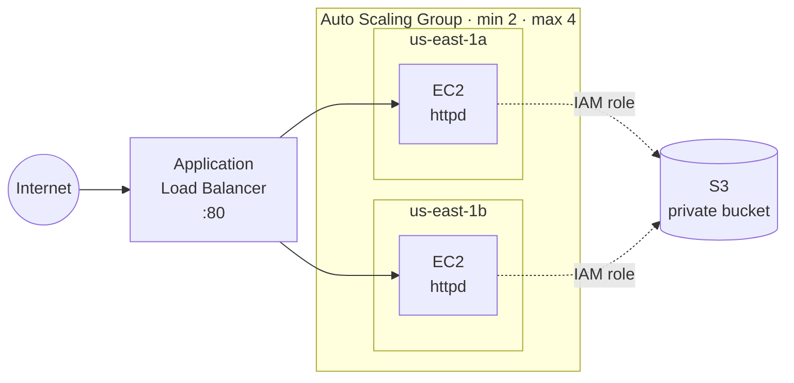
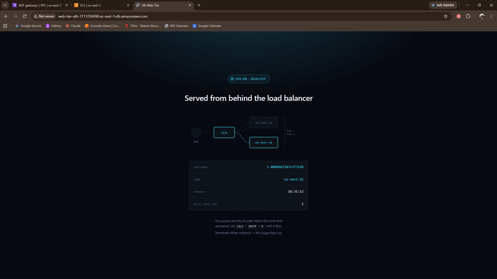
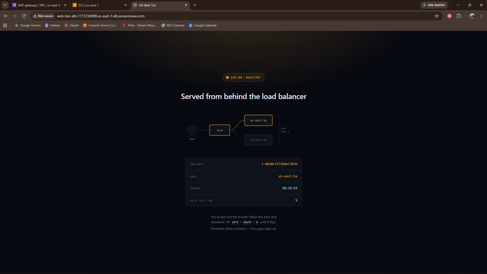
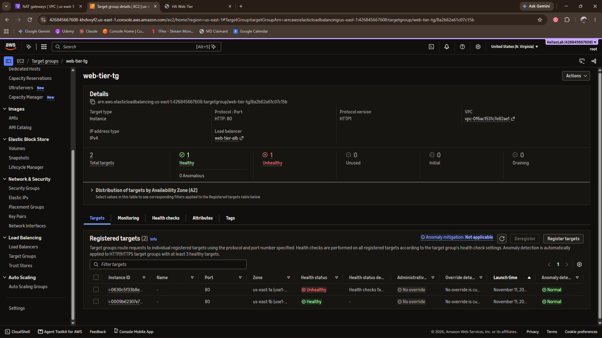

# Highly Available, Self-Healing Web Tier on AWS

A two-zone web tier behind an Application Load Balancer that replaces its own
failed instances and reads its content from a private S3 bucket with no
credentials stored on disk.

Built in the AWS console in `us-east-1`, broken on purpose, and torn down.

The interesting part of this project is not the architecture — it's the three
bugs I hit getting there, all of which failed silently and none of which were
where I was looking.

---

## Architecture



| Component | Setting | Why |
|---|---|---|
| Application Load Balancer | Internet-facing, 2 public subnets | Only resource with a public entry point |
| Target group | HTTP :80, health check `/`, 200 | Checks the app, not the host |
| Auto Scaling Group | min 2, max 4, two AZs | Losing one zone leaves a working instance |
| ASG health check type | **ELB**, not EC2 | An instance serving errors gets replaced |
| Launch template | Amazon Linux 2023, `t2.micro`, IMDSv2 required | Free tier; IMDSv2 blocks SSRF credential theft |
| S3 bucket | Block Public Access on | Content reaches the web only via the instances |
| IAM role | `s3:GetObject` on one bucket ARN | Least privilege, no access keys anywhere |

The page served by the instances renders the serving instance ID and
Availability Zone, and changes accent color per zone — so load balancing and
failover are visible in a screenshot instead of inferred from a log.

| `us-east-1a` | `us-east-1b` |
|---|---|
|  |  |

---

## Files

```
scripts/user-data.sh                 boot-time provisioning
policies/s3-read-site-content.json   IAM policy on the instance role
site/index.html                      page served by the instances
screenshots/                         console evidence
```

---

## Build it yourself

**1. S3 bucket** — Block Public Access on. Upload `site/index.html`. The object
must be named exactly `index.html` (see bug #3).

**2. IAM role** — policy from `policies/s3-read-site-content.json` with your
bucket name. Role trusted by **EC2**. The console creates the instance profile.

**3. Security groups**
- `alb-sg` — inbound HTTP :80 from `0.0.0.0/0`
- `web-sg` — inbound HTTP :80 **from `alb-sg` only**

The second one is the security story. Instances have no public ingress at all;
hitting an instance's public IP directly times out.

**4. Launch template** — AL2023, `t2.micro`, `web-sg`, IAM instance profile from
step 2, metadata **V2 only**, user data from `scripts/user-data.sh`.

**5. Target group and ALB** — target group (Instances, HTTP :80, path `/`), then
an internet-facing ALB across two public subnets with `alb-sg`, listener :80
forwarding to the target group.

**6. Auto Scaling Group** — attach the launch template, select both AZs, min 2 /
desired 2 / max 4, attach to the existing target group, and **turn on ELB health
checks**.

---

## Failure test

Terminated one instance while refreshing the ALB endpoint in a browser.

- The target group dropped to 1 healthy, 0 unhealthy
- **The site never failed to load** — the ALB routed everything to the survivor
- The ASG launched a replacement in the same AZ within ~30 seconds of detection
- The replacement booted, registered, and went healthy a few minutes later

   

No alert, no intervention, no downtime. That's the whole point of the design.

One honest note on the numbers: recovery time here was measured by refreshing
the console, not instrumented. The replacement was serving in the low single
digits of minutes, dominated by instance boot and the health check's 5
consecutive passes at 30-second intervals.

---

## The three bugs

### 1. Missing shebang — the entire script was discarded

Both instances came up with **2/2 EC2 status checks passed** and were marked
**unhealthy** by the load balancer. The ASG began replacing them, the
replacements failed identically, and it looped.

The system log had it on one line:

```
cloud-init[2105]: __init__.py[WARNING]: Unhandled non-multipart
(text/x-not-multipart) userdata: 'b'BUCKET="keita-webtier-co'...'
```

The user data had been pasted starting at `BUCKET=`, with no `#!/bin/bash`.
Cloud-init reads the first line to decide how to handle the payload. No shebang
means no handler, so it logged that warning and **threw the whole script away.**
Apache was never installed. Nothing was listening on :80. The health check got
connection refused.

**What it taught me:** EC2 status checks report on the hypervisor and the OS.
They say nothing about whether the application works. The gap between "the
instance is fine" and "the application is fine" is exactly why the ASG health
check type should be ELB rather than EC2 — and this failure is what that setting
exists to catch.

### 2. A passing health check on a completely wrong page

After fixing the shebang, the targets went healthy — and the site served
Apache's default **"It works!"** page.

The `aws s3 cp` had failed. With `set -euo pipefail`, the script aborted at that
line, but Apache had already been installed and started by the preceding lines.
With an empty document root, AL2023's httpd falls back to its built-in welcome
page, which returns **HTTP 200**. The health check was perfectly satisfied by a
page that had nothing to do with the application.

**What it taught me:** a health check pointed at `/` proves that *something*
answered with a 200. It does not prove the deploy worked. A real health check
should hit a path that only exists if the application deployed correctly —
`/healthz` written by the deploy itself, not the web server's default.

### 3. Filename mismatch — and a console filter that hid the recovery

The S3 object was named `index_4.html`, then `index (2).html` — Windows appended
suffixes on download because a file of that name already existed locally. The
script asks for `s3://bucket/index.html`, got a 404, and died there (bug #2).

Separately, while debugging, the target group page had a **"Health status:
unhealthy"** filter applied from an earlier click. Two healthy targets were
registered and the page was showing "2 matches" of unhealthy ones. I spent
several minutes diagnosing a system that had already recovered.

**What it taught me:** check what the view is filtering before trusting what it
shows. And user data runs **once**, on first boot — changing the object in S3
does nothing to instances that already copied it. The only way to pick up new
content is to replace the instances, which is also the failure test.

---

## What I'd change in production

- **Health check path** — a `/healthz` endpoint written by the deploy, so a
  default page can't pass
- **Don't bake content at boot** — pull on a schedule, or deploy via CodeDeploy /
  SSM, so content updates don't require replacing instances
- **Log user data output to a known file** and ship it to CloudWatch Logs, rather
  than reading it out of the EC2 system log one instance at a time
- **Minimum healthy percentage** — 90% on a 2-instance group makes rolling
  updates crawl; 50% is appropriate at this size
- **Define it in code** — this was built by clicking, which is why a missing
  shebang survived three rebuilds. Terraform or CloudFormation next.

---

## Cost and teardown

| Resource | Cost |
|---|---|
| EC2 `t2.micro` ×2 | Free tier (750 hrs/month, 12 months) |
| S3 | Pennies at this size |
| **Application Load Balancer** | **~$0.0225/hr — about $16/month** |

The ALB is not free tier. Teardown order:

1. Delete the Auto Scaling Group (terminates its instances)
2. Delete the load balancer
3. Delete the target group

No NAT Gateway in this design. It would cost ~$32/month and nothing here needs
one — the instances reach S3 through the public subnet. In a private-subnet
design the right answer is a VPC gateway endpoint for S3, which is free.
